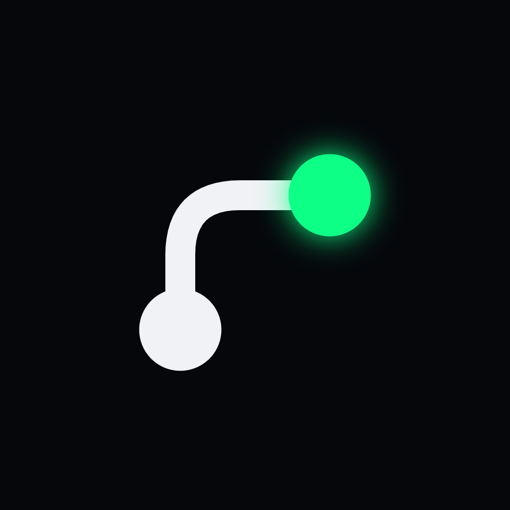

# Diego Cabré

**Full Stack Developer Jr.** · React · Next.js · TypeScript · Node.js · PostgreSQL
*Conectando innovación con confiabilidad.*

[Portfolio](https://diegocabre.vercel.app) · [Descargar CV](https://diegocabre.vercel.app/cv-diego-cabre.pdf) · [LinkedIn](https://www.linkedin.com/in/diegoantoniocabreperrone/) · diegocabre@gmail.com

Desarrollador full stack en Puerto Varas, Chile (100% remoto). Desde 2025 construyo sitios y aplicaciones para empresas chilenas de punta a punta: requerimientos, diseño, desarrollo, pruebas y mantención en producción. Antes, más de 15 años en ventas consultivas B2B y Business Intelligence.

## Proyectos en producción

| Proyecto | Qué resuelve | Stack |
|---|---|---|
| [Reservas Cabañas Sur](https://reservas.solucionesdys.cl) · [código](https://github.com/diegocabre/reservas-cabanas) | Reserva directa de cabañas con pago del abono en Mercado Pago, sin comisiones de plataforma | Next.js, Prisma, PostgreSQL, Supabase, Vitest |
| [Estribor Consultores](https://www.estriborconsultores.cl) · [código](https://github.com/diegocabre/estribor) | Sitio corporativo, portal de empleo con panel por roles y agenda de reuniones | Next.js, Supabase, Zod, Playwright |
| [Caroline Magic](https://www.carolinemagic.cl) · [código](https://github.com/diegocabre/carolinemagic) | Catálogo con reserva por WhatsApp y panel privado de contenido | Next.js, TypeScript, Vercel Blob |
| [Dogtoralia Vet](https://www.dogtoraliavet.cl/home) · [código](https://github.com/diegocabre/dogtoralia) | Clínica veterinaria con dos sedes y tienda vitrina de 108 productos | Next.js, Zod, Resend |
| [Soluciones DyS](https://www.solucionesdys.cl) · [código](https://github.com/diegocabre/solucionesdys) | Sitio propio con blog en MDX, caché en Redis y CI en GitHub Actions | Next.js, Redis, Supabase, Vitest |

## Stack

           

---

## Sobre este repositorio

Código del portfolio publicado en [diegocabre.vercel.app](https://diegocabre.vercel.app).

**Tecnologías:** Next.js 16 (App Router), React 19, TypeScript estricto, Tailwind CSS 4, `motion`, Resend y Zod.

```bash
npm install
cp .env.example .env   # completar RESEND_API_KEY y EMAIL_TO
npm run dev
```

| Ruta | Contenido |
|---|---|
| `src/data/` | Datos tipados del sitio, stack, trayectoria y proyectos |
| `src/components/sections/` | Secciones de la página (hero, stack, proyectos, sobre mí, contacto) |
| `src/app/api/sendEmail/` | API del formulario de contacto (Zod, honeypot, Resend) |
| `brand/` | Logo en PNG para fotos de perfil |
